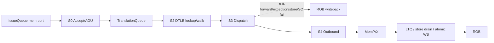

# DTLB 流水线与非阻塞改造方案（P2/P3）

## 1. 范围

P0/P1 已完成：

- `LsuMmu` 封装 `DTLB` + `Sv32Translator`，LSU 不再直接实例化 translator；
- `MmuTranslateResp` 已带 `vaddr/pte/level/fill`；
- `RetireUnit.sfence` 已接到 DTLB，V0 全刷；
- DTLB refill 握手已修（refill 拍撤销 `missReq`）；
- M/bare 模式在 `LsuMmu` 内绕过 DTLB；
- PTW 已 speculative，`Mem` 只对 device/atomic 做 ROB-head 门控；
- 完整回归通过。

本文只规划**尚未实现**的部分：

- P2：把 LSU 翻译前端改成流水线（TranslationQueue + S0/S1/S2/S3/S4/WB）；
- P3：DTLB 非阻塞（miss queue、hit-under-miss、replay）。

P2 开始前先做 **P2.0 基线**：用大工作集的 Sv32 测试在当前 blocking DTLB 上测量 cycles/IPC/LSU stall，记录后再改流水线。

本次不做 L2 TLB、Page Cache、提高 LTQ/store txn/outbound 容量；这些留到后续任务。

本文不再重复 P0/P1 的模块细节；已实现的行为作为下面各模块的既有时序前提。

---

## 2. 现有基线与时序前提

实现文件：

```text
playground/src/core/backend/lsu/LsuMmu.scala
playground/src/core/backend/lsu/DTLB.scala
playground/src/core/backend/lsu/DtlbArray.scala
playground/src/core/backend/lsu/DtlbPermissionCheck.scala
playground/src/core/mmu/Sv32Translator.scala
playground/src/core/mmu/MmuBundle.scala
```

必须保持的前提：

- DTLB 命中：`req.fire` 后 1 拍 `resp.valid`，`resp.ready` 低时保持；
- DTLB miss：`sWalk` 等 walker，`refill.fire` 后 1 拍响应，fill 与响应同拍完成；
- `flush` 只杀在途请求，不清 entry；
- `sfence` 清 entry，并杀死在途 walk/fill；
- M/bare 在 `LsuMmu` 内 bypass，不写 entry；
- PTW 读可以 speculative 发出；recover/flush 由 `abort`/`ptwKilled` 丢弃；
- `sfence` 退休时是 barrier（先 `storesDrained`，再 `globalFlush`），所以 PTE 更新对 walker 可见；
- 当前 LSU 仍是 blocking：一次一个 memory op，没有 TranslationQueue；load/store 在翻译完成后的所有权交给 LTQ/SQ/drain。

当前容量：

```text
loadTxnEntries      = 2
storeQueueEntries   = 16
storeTxnEntries     = 4
dmemQueueEntries    = 4
dtlbEntries         = 16
```

---

## 3. 流水线总体

### 3.0 基线（P2.0，先做）

开始 P2 之前，先在**当前 blocking DTLB**（P0/P1 代码，无 TranslationQueue）上跑一组大工作集 Sv32 测试，记录基线。P2.0 不改 RTL，只加测试和记录。

**为什么需要专门的大测试**

现有 `sv32-basic`/`sv32-superpage-data` 只有几个页、几千 cycles，看不到 TLB miss/阻塞的真实成本。新的测试把工作集放大到 1 MiB / 256 个 4 KiB 页，并跑 1M 次访问；用同一测试的 4 MiB 超页版本作对照，两者的 cycles 差就是“TLB walk + fill + miss 阻塞”的近似成本。

**测试矩阵**

| 测试 | 页表 | 工作集 | 访问 | 访问数 | 目的 |
|---|---|---|---|---|---|
| `sv32-dtlb-seq-4k` | 4 KiB 页 | 1 MiB / 256 页 | 顺序 load | 262144 | TLB 容量 + 顺序吞吐 |
| `sv32-dtlb-seq-4m` | 4 MiB 超页 | 1 MiB / 1 项 | 顺序 load | 262144 | 4K 的对照 |
| `sv32-dtlb-strided-4k` | 4 KiB 页 | 1 MiB / 256 页 | 每页一个 word，轮转 | 1048576 | 高 TLB miss、几乎不靠 DCache 局部性 |
| `sv32-dtlb-strided-4m` | 4 MiB 超页 | 1 MiB / 1 项 | 同上 | 1048576 | 4K 的对照 |
| `sv32-dtlb-random-4k` | 4 KiB 页 | 1 MiB / 256 页 | LCG 随机页 | 1048576 | 随机 TLB/DCache |
| `sv32-dtlb-random-4m` | 4 MiB 超页 | 1 MiB / 1 项 | 同上 | 1048576 | 4K 的对照 |
| `sv32-dtlb-store-4k` | 4 KiB 页 | 1 MiB / 256 页 | 顺序 store | 262144 | store queue + TLB |

共同点：

- 数组在 `.data` 初始化为 1；S-mode 负载求和，M-mode 检查结果（load 测试期望 `N`，store 测试期望 1）；
- 4 KiB 版本用二级页表，4 MiB 版本用根表 leaf；两者都映射 `0x80000000..0x803fffff`；
- `.bss` 只放栈和页表；4K/4M 的页表 setup 都在 cycles 内；数组不走 M-mode 填充，避免 store queue 噪声；
- 4K 版本多一次 1024 项 l0 表 setup（约 1K stores），相对 1M 次负载很小，但读差值时要记住它。

**运行方式**

```bash
cd dissue
make -C test run EXT=riscv32ima ALL="sv32-dtlb-seq-4k sv32-dtlb-seq-4m \
  sv32-dtlb-strided-4k sv32-dtlb-strided-4m \
  sv32-dtlb-random-4k sv32-dtlb-random-4m sv32-dtlb-store-4k"
```

测试源：

```text
test/riscv32ima/tests/dtlb_bench.h
test/riscv32ima/tests/sv32-dtlb-*.S
```

日志：

```text
test/build/riscv32ima/logs/sv32-dtlb-*.log
run/perf/dtlb-baseline/            # 基线日志快照
```

**指标**

从 checker 日志取：

```text
cycles
total commits
ipc
DCache: access/hit/miss/hit rate
IssueQueue ready-block breakdown: LSU unavailable
StoreQueue: full stall cycles / avg occupancy
Store forwarding: unresolved-store stall cycles
```

`TlbMonitor` 目前没有接到 checker/DPI，所以没有 DTLB hit/miss 计数；本基线用：

```text
4K cycles - 4M cycles          # TLB walk/fill/miss 阻塞的近似成本
LSU unavailable cycles         # LSU 不可用（含 DTLB miss）的停顿
DCache miss                    # 页表 walk 和数据的存储侧代价
```

**当前基线结果（P2 前）**

| 测试 | pages | cycles | commits | IPC | DCache hit | LSU unavailable | StoreQueue full stall |
|---|---:|---:|---:|---:|---:|---:|---:|
| seq-4k | 256 | 1402738 | 1334363 | 0.951 | 49.28% | 133647 | 7667 |
| seq-4m | 1 | 1454110 | 1318999 | 0.907 | 49.66% | 197389 | 4851 |
| strided-4k | 256 | 8674453 | 7363675 | 0.849 | 0.01% | 2359299 | 7667 |
| strided-4m | 1 | 6303005 | 7348311 | 1.166 | 0.01% | 11 | 4851 |
| random-4k | 256 | 14952405 | 10509408 | 0.703 | 0.49% | 663369 | 7667 |
| random-4m | 1 | 9795500 | 10494044 | 1.071 | 0.81% | 9 | 4851 |
| store-4k | 256 | 1532769 | 1072220 | 0.700 | 0.54% | 12298 | 979314 |

7 个测试全部 PASS（`HIT GOOD TRAP`）。基线日志在 `run/perf/dtlb-baseline/`。

**基线观察**

- `strided-4k` 比 `strided-4m` 多 **2.37M cycles（+37.6%）**，`LSU unavailable` 从 11 涨到 **2.359M**，IPC 从 1.166 降到 0.849。每页一个 word 的连续访问把 blocking DTLB 的 miss/refill 暴露得最清楚。
- `random-4k` 比 `random-4m` 多 **5.16M cycles（+52.6%）**，`LSU unavailable` 从 9 涨到 **663K**，IPC 从 1.071 降到 0.703。随机页访问的 TLB 成本明确。
- `seq-4k` 比 `seq-4m` 少 51K cycles（-3.5%），`LSU unavailable` 也低；顺序访问只碰 256 个页且每个页连续用 1024 次，TLB miss 只有 256 次，4K/4M 差异被代码/DCache layout 噪声盖过。**顺序测试不作为 TLB 差值主指标**，只作吞吐对照。
- `store-4k` 的 `StoreQueue full stall` 是 **979K**，`LSU unavailable` 只有 12K；瓶颈在 store queue/drain，不在 DTLB。这个测试提醒 P2：S3 store 的 TQ 流水无法解决 SQ 容量瓶颈；提高 SQ/txn 容量不在本次范围。
- `strided` 的 LSU stall 比 `random` 还高（2.359M vs 663K），因为 strided 的 load 是背靠背独立访问，DTLB miss 直接堵住 LSU；random 的 LCG 依赖和 DCache miss 降低了发射压力。
- 4M 对照的 `LSU unavailable` 只有 9–11，说明 hit 路径本身不是主要停顿；主要成本是 miss/walk + blocking。

**判读**

- 如果 `4K - 4M` 的 cycles 差很大，说明当前 blocking DTLB 的 walk/miss 是主要瓶颈，P2 的 TQ + hit 流水和 P3 的 miss queue 有明确收益；
- 如果差不大，但 `LSU unavailable` 高，说明瓶颈在 LSU 的串行状态机/发射间隔，P2 的流水级同样有收益；
- 如果 `StoreQueue full stall` 高，说明 store 侧先于 TLB 成为瓶颈，P2 不能只看 DTLB；
- P2/P3 完成后用同一组测试重跑，比较 cycles/IPC 和 4K/4M 差值，而不是只看 microbenchmark 的绝对 IPC。

### 3.1 级划分

```text
S0 Accept / AGU / 非对齐 / CSR 快照
  -> S1 TranslationQueue
  -> S2 DTLB lookup / walk / bypass
  -> S3 Dispatch
       load  -> SQ forwarding + LTQ alloc
       store -> SQ update + ROB writeback
       exception / SC fail / full-forward -> ROB writeback
       device load -> park 或 head 检查
       AMO/LR/SC -> atomic 路径
  -> S4 Outbound arbiter / memory
       load request / store drain / PTW / atomic
  -> WB LTQ / store drain / atomic response
```



### 3.2 程序序前提（关键）

当前 `IssueQueue` 的 mem port 是“最老的 ready 请求先发”。这允许**年轻 store 越过 older load**，也允许 LSU 收到的 memory op 不是程序序。

TranslationQueue 如果只是 FIFO，会出两个问题：

1. 年轻 store 先入队、older load 后入队；TQ 按到达序处理，`recover` 的“删年轻项”不再成立；
2. older load 可能还停在 IssueQueue 里没发，TQ 根本不知道它存在，S3 会先处理年轻 op。

因此 **P2 必须先把 memory issue 变成程序序**：

- `IssueQueue` 的 mem port 只允许最老的 memory entry 发射；
- 如果最老 memory entry 的 operands 未 ready，年轻 memory op 等待；
- 现有 `loadBlocked`（load 等 older store）和 `amoOrderBlocked`（等 older AMO）保留；
- 这样 TQ 是程序序 FIFO，`recover` 可以安全地按 robIdx 截尾。

代价：

- 年轻 store 不能越过 older load 发射；
- 但 LSU 本来就是单发射，TQ 的收益来自“S0 接收”和“翻译/分发解耦”，不是 memory-level parallelism；
- 如果将来要恢复 store 越过 load，需要 dispatch-time memory sequence 或 age-ordered TQ，另立设计。

### 3.3 时序

定义：

- N：S0 接受 `io.in.fire`、TQ enq；
- N+1：TQ head 在 S2 发 DTLB req；
- N+2：DTLB hit 响应，S3 dispatch；
- N+3：S4 outbound（load）或 store 已完成。

命中、逐周期接收（需要 DTLB hit 流水，见 §4.4）：

| 周期 | S0 | S1/TQ | S2 | S3 | S4 |
|---|---|---|---|---|---|
| N | A enq | | | | |
| N+1 | B enq | A head | A lookup | | |
| N+2 | C enq | B head | B lookup | A dispatch | |
| N+3 | D enq | C head | C lookup | B dispatch | A outbound |

- TQ 把 S0 和 S3 解耦；S0 在 TQ 未满时每周期接收。
- 如果 DTLB 仍是当前 0.5 请求/周期，S2/S3 每两拍推进一次，TQ 会填满并反压 S0；稳态吞吐 0.5。
- P2 建议同时做 DTLB hit 流水，使命中路径能每周期一个 lookup（见 §4.4）。

单条 load（hit）：

| 周期 | 事件 |
|---|---|
| N | S0 接受 + AGU + 非对齐检查 + TQ enq |
| N+1 | S2 DTLB lookup（hit） |
| N+2 | DTLB resp + S3 SQ query + LTQ alloc + TQ pop |
| N+3 | S4 outbound fire |
| R | Mem response 由 LTQ 写回 ROB（与 LSU 其他级并行） |

单条 store（hit）：

| 周期 | 事件 |
|---|---|
| N | S0 接受 |
| N+1 | S2 lookup（hit） |
| N+2 | S3 SQ update + ROB writeback + TQ pop |
| 之后 | commit 后由 SQ/drain engine 发 memory，LSU 不再参与 |

DTLB miss：

| 周期 | 事件 |
|---|---|
| N | S0 接受 |
| N+1 | S2 `sWalk`，`missReq` 拉高，walker 发 PTE 读 |
| N+1..M | walker / PTW 延迟；TQ head 等待；S0 继续入队直到 TQ 满 |
| M | `refill.fire`，DTLB fill |
| M+1 | DTLB resp，S3 dispatch |
| M+2 | S4 outbound（load） |

TQ 满 / S3 stall / S4 stall：

| 事件 | 反压 |
|---|---|
| TQ 满 | S0 `in.ready` 拉低；IssueQueue mem port 停；非 memory 发射不受影响 |
| S3 SQ unresolved / LTQ 满 | TQ head 保持；S2 响应保持；TQ 逐渐填满；S0 停 |
| S4 outbound 满 / arbLocked | S3→S4 skid 满；S3 停；TQ/S2/S0 依次反压 |
| WB 端口冲突 | LTQ/store drain 响应保持；`allowComplete` 由 S3 直接写回优先 |

### 3.4 流水线寄存器与停顿

P2 需要新增：

- S2→S3 寄存器：保存当前 TQ head 的 `TranslationRequest` 和 DTLB 响应；S3 只使用该寄存器，不再读 TQ head；
- S3→S4 skid（一项）：保存 load 的 `paddr/txnId/robIdx`、atomic 事件、store drain 事件；
- TQ 的 `head` 在 `pop` 时组合前进到下一项；S3 完成的同拍，S2 就可以用下一项发 DTLB lookup；
- S2→S3 的响应保持：S3 未 ready 时，DTLB `resp` 和 S2→S3 寄存器保持；
- TQ 的 head 在 S2/S3 完成前不 pop；
- S0 的 misaligned 异常仍可原地写回，不入 TQ；
- S0 的 CSR 快照（mstatus/satp/priv）随 TQ entry 保存；CSR 写是 barrier/globalFlush，会清 TQ，所以不存在快照过期。

S2→S3 寄存器是 1/cycle 的关键：

```text
N+1: TQ head A -> s2ToS3.req; DTLB req A
N+2: DTLB resp A -> s2ToS3.resp; S3 dispatch A; TQ pop A
     TQ head 组合前进到 B; DTLB req B
N+3: S3 dispatch B; TQ pop B; TQ head C; DTLB req C
```

如果 S3 stall，`pop` 不拉高，TQ head 保持，DTLB 不再接受新 lookup；`head` 不会跳过未完成的 A。

---

## 4. Module 设计

### 4.1 BackendConfig

新增：

```scala
translationQueueEntries:   Int = 4
dtlbResponseEntries:       Int = 1   // hit 流水/response skid
dtlbMissQueueEntries:      Int = 4   // P3
translationReplayEntries:  Int = 2   // P3
```

派生：

```scala
translationQueueIdxWidth
translationQueueCountWidth
translationIdWidth   // 队列索引 + generation，P3 防止 entry 复用后的 stale response
dtlbMissQueueIdxWidth
dtlbMissIdWidth      // miss 索引 + generation
translationReplayIdxWidth
```

所有索引宽度、计数宽度由 config 派生，不在模块内硬编码。`dtlbMissQueueEntries` 和 `translationReplayEntries` 在 P2 可以先不生成逻辑，但接口和位宽预留。`reqId/missId` 在 P2 可以只用队列索引或单调计数；P3 必须带 generation，避免旧响应/旧 fill 命中已经复用的项。

### 4.2 TranslationRequest / TranslationQueue

**TranslationRequest**

```scala
class TranslationRequest(cfg) extends Bundle {
  val robIdx      = UInt(cfg.robIdxWidth.W)
  val reqId       = UInt(cfg.translationIdWidth.W) // P2: 队列索引；P3: 索引 + generation
  val sqIdx       = UInt(cfg.sqIdxWidth.W)
  val vaddr       = UInt(cfg.addrWidth.W)
  val access      = UInt(MmuAccessType.width.W)
  val priv        = UInt(PrivMode.width.W)
  val mstatus     = UInt(cfg.dataWidth.W)
  val satp        = UInt(cfg.dataWidth.W)
  val memSize     = UInt(3.W)
  val memUnsigned = Bool()
  val fuOp        = UInt(FuOp.width.W)
  val isAmo       = Bool()
  val src2Data    = UInt(cfg.dataWidth.W)
  val exception   = new ExceptionInfo(cfg)
}
```

注意：store 的 `sqIdx/src2Data`、load 的 `memSize/unsigned`、AMO/LR/SC 的 `fuOp` 都必须随 TQ 走；只在 S0 保存 `vaddr/access/priv` 是不够的。

**接口**

```scala
val enq:       Flipped(Decoupled(new TranslationRequest(cfg)))
val head:      Output(new TranslationRequest(cfg)) // 当前 lookup 项；pop 时组合前进到下一项
val headValid: Output(Bool())
val pop:       Input(Bool())
val flush:     Input(Bool())
val recover:   Input(new RobRecovery(cfg.robIdxWidth))
val occupancy: Output(UInt(cfg.translationQueueCountWidth.W))
val full:      Output(Bool())
val empty:     Output(Bool())
```

**内部 module**

- 一个程序序 FIFO（`entries` + `head`/`tail`/`count`）；
- `recover` 的截尾逻辑（`RobAge` 比较 + compact）；
- 可选的 one-entry skid：S0 到 FIFO 之间，用于打断 enq 到 `head` 的组合路径；
- 不需要额外子模块；计数/compact 直接在本模块实现。

**功能**

- S0 `enq`；
- S2 把 `head` 捕获进 `s2ToS3.req`，并用它发 DTLB lookup；
- S3 完成时 `pop`；`pop` 同拍 `head` 组合前进到下一项，S2 可以立即发下一个 lookup；
- `recover` 删除 robIdx 之后的年轻项（FIFO 程序序，等价于截尾）；
- `flush` 清空；
- `full` 反压 S0。

**时序**

- enq 在 S0 的时钟边沿写入；
- `head` 组合输出；当 `pop` 有效且下一项 valid 时，`head` 直接指向下一项（lookahead），不是等到下一拍；
- `pop` 在 S3 完成的同一拍；
- `recover`/`flush` 优先于 enq/pop；
- 队列满时 `enq.ready` 低。

**不变量**

- TQ 内严格程序序；
- 只要 TQ 非空，head 就是最老的未完成 memory op；
- P2：`pop` 只能由 S3 发出，且被 pop 的项必须已经捕获到 `s2ToS3`（或 S3 完成），不能 pop 一个还没 lookup 的项；
- P3 例外：head miss 被移到 ReplayQueue 时，S2 也可以 pop；此时 `head` 前进到下一项，miss 的响应由 replay/`reqId` 跟踪；
- `pop` 和 `head` 的 lookahead 必须保证：S3 的请求字段来自 `s2ToS3`，不会因为 `head` 前进而丢失。

### 4.3 LsuMmu

**接口（P2）**

```scala
val req:  Flipped(Decoupled(new MmuTranslateReq(cfg)))  // 来自 TQ head
val resp: Decoupled(new MmuTranslateResp(cfg))          // 到 S3

val ptwReq:  Decoupled(new DataMemReq(cfg.addrWidth, cfg.dataWidth))
val ptwResp: Flipped(Decoupled(new DataMemResp(cfg.dataWidth)))

val sfence: Valid(new TlbSfence(cfg))
val flush:  Bool

val monitor: TlbMonitor
```

`MmuTranslateReq/Resp` 增加/透传：

```scala
req.bits.robIdx / req.bits.reqId
resp.bits.robIdx / resp.bits.reqId
```

P2 的 TQ 是程序序且单 outstanding，`reqId` 暂时只用于 monitor/断言；P3 用于乱序 response 匹配。

**内部 module**

- `DTLB`
- `Sv32Translator`
- `TranslationResponseQueue`（P2 新增，一项或 `dtlbResponseEntries` 项）
- M/bare bypass 的一拍寄存（已实现）

**功能**

- TQ head 的请求先判 `translateDisabled`：M/bare 走 bypass，一拍响应 identity；
- 否则进 DTLB：hit 直接响应；miss 拉 `missReq`，walker 返回后 `refill`；
- walker 的 `resp` 适配成 `TlbRefill`（vaddr/pte/level/paddr/fill/exception）；
- `flush` 杀在途；`sfence` 失效 entry；`walkFlush` 杀 walker；
- response queue 把 DTLB 的响应和 S3 解耦。

**时序**

- hit：`req.fire` N，`resp.valid` N+1；
- miss：`req.fire` N，`sWalk` N+1，`refill.fire` M，`resp.valid` M+1；
- bypass：`req.fire` N，`resp.valid` N+1；
- response queue 满时，`resp` 保持；S3 停；
- P3 的 miss queue 见 §5。

### 4.4 DTLB

P2 只增加两件事：

1. **req/resp 透传 `robIdx/reqId`**；
2. **hit 流水**，让 TQ 能每周期送一个 lookup。

**接口（P2 增量）**

```scala
req.bits.robIdx / req.bits.reqId
resp.bits.robIdx / resp.bits.reqId
```

**hit 流水（推荐）**

当前：

```text
req.ready := state === sIdle && !respValid && ...
```

问题：hit 响应在 N+1 被消费后，N+2 才能接下一个请求，持续吞吐 0.5。

P2 改成：

```text
req.ready := (state === sIdle && !respValid) ||
             (state === sResp && resp.fire)
```

在 `sResp` 且 `resp.fire` 的同一拍接受新请求：

- 组合 lookup 新请求；
- 如果 hit：更新 `respReg` 为新请求的响应，状态保持 `sResp`；
- 如果 miss：记录 `pendingReq/pendingVictim`，状态进 `sWalk`；
- 如果 `lookupMultiple`：清 TLB，进 `sWalk`；
- 旧响应已被 `resp.fire` 消费，不会丢。

`sfence`/`flush` 与 `sResp` 接受新 req 同拍时，失效/杀死优先：

- `sfence` 先清 entry，再判新 req 的 lookup；新 req 不能命中本拍被 invalidate 的 entry；
- `flush` 直接取消新 req；
- `refill` 与 `sfence` 同拍时 `sfence` 优先（P3 的 fill 竞争规则从现在开始统一）。

这样命中路径可以每周期一个 `req.fire`，S2/S3 每周期推进。`resp.ready` 低时仍保持，不接新请求。

**时序（hit 流水）**

| 周期 | req | resp |
|---|---|---|
| N | A fire | |
| N+1 | B fire（同拍 A resp.fire） | A valid/fire |
| N+2 | C fire（同拍 B resp.fire） | B valid/fire |

**miss**：B 在 N+1 进 `sWalk`，A 的响应已消费；B 的 refill 后响应。TQ head 是 B；TQ 继续接收年轻项直到满。

**内部 module**

- `DtlbArray`：不变；
- `DtlbPermissionCheck`：不变；
- 新增 hit 流水的控制（在 DTLB 内，不需要新 module）。

**P3 增量**

见 §5：miss queue、`missId`、miss 期间 hit、victim 预留、多 outstanding miss；`req/refill` 增加 `missId`，fill 与 sfence 竞争需要 epoch/tag。

### 4.5 Sv32Translator

**接口（P2 不变）**

```scala
val req:     Flipped(Decoupled(new MmuTranslateReq(cfg)))
val resp:    Decoupled(new MmuTranslateResp(cfg))
val memReq:  Decoupled(new DataMemReq(cfg.addrWidth, cfg.dataWidth))
val memResp: Flipped(Decoupled(new DataMemResp(cfg.dataWidth)))
val flush:   Input(Bool())
```

**内部 module**

- 两级 PTE walk 状态机（Sv32）；
- PTE 权限/页错误检查；
- `MmuMemReq.pteRead` 生成 PTE 读请求；
- 没有额外子模块。

**功能**

- 单 walker；`resp` 已带 `vaddr/pte/level/fill`；
- 由 LsuMmu 的 `walkFlush` 驱动 `flush`；
- PTE 读走 `memReq`，`memResp` 返回；
- 超页（4MB）在第一级结束。

**时序**

- `req.fire` 后进入 walk；
- 每个 PTE 读需要 `memReq.fire` + `memResp.fire`；
- 命中/页错误后 `resp.valid`；
- `flush` 杀 walk，`resp` 不产生；
- P2 不改变这个时序。

P3 如果保持“一个 walker + miss queue”，不需要改 PTW tag；如果要多 walker，才需要扩展 `DataMemTxn.ptwTag` 和 response 路由，不在本次范围。

### 4.6 LSU

**接口（P2）**

保留现有 `io.in`、SQ/LTQ、`dmemReq/dmemResp`、`flush/recover`、`sfence`、`csrStatus`，新增/变化：

```scala
val in: Flipped(Decoupled(IssuePacket))
// in.ready 由 TQ 空间和 memory 发射顺序决定

val loadReady / storeReady / atomicReady: Bool
// P2 改为“TQ 可接收 + 对应顺序约束”
```

**内部 module**

- `TranslationQueue`（新）
- `LsuMmu`（已有）
- `LoadTxnQueue`
- `StoreQueue`
- `StoreDrainEngine`
- `RecoverableDmemQueue`
- S2→S3 寄存器（新，一项）
- S3→S4 skid（新，一项）
- writeback/arbiter（现有逻辑重组）

**S0**

- `src1 + imm`、非对齐检查；
- 读 CSR 快照；
- misaligned：原地写回异常，不入 TQ；
- 否则构造 `TranslationRequest`，`tq.enq`；
- `in.ready = tq.enq.ready && ...`；misaligned 不占 TQ，`in.ready` 只受 `baseReady` 限制；
- 不再在 S0 检查 LTQ 是否满；LTQ 满在 S3 反压 TQ。

**S1**

- TQ 存储；head 送给 S2；
- 无独立逻辑。

**S2**

- 把 `tq.head` 捕获进 `s2ToS3.req`（含 `robIdx/sqIdx/src2Data/memSize/isAmo/...`）；
- 用该请求驱动 `LsuMmu.req`；
- 等待 `LsuMmu.resp`，写入 `s2ToS3.resp`；
- 响应保持到 S3 ready；
- miss 时等待 refill；TQ head 不 pop。

**S3**

- 使用 `s2ToS3.req/resp`，不再直接读 TQ head；
- load：
  - SQ forwarding query（older store）；
  - full-forward：ROB writeback，TQ pop；
  - partial/no-forward：LTQ alloc；`paddr/txnId` 进 S4 skid；
  - `query.unresolved` 或 LTQ 满：stall（不 pop）；
- store：
  - SQ update（单端口）+ ROB writeback + TQ pop；
  - store 的 commit/drain 由 SQ/drain engine 负责；
- exception：ROB writeback，TQ pop；
- SC fail：写回 1，TQ pop；
- device load：
  - head/storesDrained/LTQ empty 不满足 → park；
  - 满足 → 走 load 路径；
- AMO/LR/SC：
  - LR/AMO → atomic read；
  - SC → atomic write；
  - 必须在 ROB head；`atomicReady` 约束见下；
- 完成时 `tq.pop`；同拍 `tq.head` 组合前进到下一项，S2 可以发下一个 lookup（如果 DTLB 能接）；
- `storeUpdate`/`storeRequest`/`storeResponse` monitor 保持。

**S4**

- outbound arbiter：atomic > PTW > serialized > fair(load/store)；
- load request（LTQ tag）；
- store drain engine 的 committed store；
- PTW（walker 的 PTE 读）；
- atomic read/write；
- `outbound` 满或 `arbLocked` 时停；S3 skid 满则反压 S3。

**WB**

- LTQ response → ROB writeback/wakeup；
- store drain response → SQ free/ROB；
- atomic response；
- 直接写回（S3 exception/full-forward/store/SC fail）优先；
- `allowComplete` 保持现有优先级。

**ready 信号（P2）**

```text
baseReady   = !io.flush && !io.recover.valid &&
              !serializedPending && !pendingDeviceReady
loadReady   = tq.enq.ready && baseReady
storeReady  = tq.enq.ready && baseReady
atomicReady = tq.empty && tq.enq.ready && baseReady &&
              loadTxns.empty && storesDrained && !ptwBusy && !atomicBusy
```

- `baseReady` 必须包含 `!io.flush && !io.recover.valid`，否则 recover 当拍 S0 会接收一个年轻于 boundary 的新 op，而 TQ 的截尾只作用于已有项；
- `serializedPending` 必须继续挡住 S0，否则 MMIO store 的 younger memory op 会先进入流水线；
- `serializedPending` 同时必须停住 S4：MMIO store 的 response 之前，younger load/store 不得访问内存；S3 仍可做翻译/SQ 登记，但 LTQ/SQ 满后会反压；
- `atomicReady` 要求 `tq.empty` 是新增的：AMO 必须等到所有 older memory op 都完成/入队并处理完；
- `deviceLoadOrderingReadyFor` 加 `tq.empty` 检查（device load 在 head 且 TQ 无 older 项），保留 `serializedPending`；
- `memoryIdle`/`busy` 必须包含 TQ、S2、S3、S4 skid、LsuMmu pending；
- `loadTxnFullStall` 改为 S3 stall 的 monitor 事件。

**flush/recover**

- `io.flush`：清 TQ、清 S2/S3/S4 寄存器、LsuMmu flush、outbound/LTQ/SQ recover；
- `recover`：
  - TQ 按 robIdx 截尾；
  - S2 的 `s2ToS3.req`、S3 的 `s2ToS3`、S4 skid 分别用 `RobAge` 比较，年轻于 boundary 的杀死；
  - 如果被杀的项是 S2 正在 lookup/等待的项（head 或 lookahead），拉 `LsuMmu.flush`；DTLB entry 不清；
  - 如果 S3 已完成的项被 kill，抑制它的直接 writeback、SQ update、LTQ alloc；LTQ/SQ 走现有 recover；
  - 如果 head A 保留、只杀年轻 B，不能 flush 掉 A 的 S3 响应；只杀 B 的 lookup 即可（`LsuMmu.flush` 不影响已经进入 S3 的 A）；
- `sfence`：与 globalFlush 同拍，DTLB 失效；TQ 清空；
- `recover` 不清 TLB entry。

### 4.7 LoadTxnQueue

P2 接口不变：

```text
alloc / allocTxnId / markIssued / abort
complete / allowComplete
writeback / wakeup
flush / recover / cancel
occupancy / empty
```

- S3 load 分配 LTQ；
- S4 load request 用 `txnId`；
- response 由 WB 写回；
- `recover` 保留 killed tag 到 response/cancel（现有语义）；
- P2 容量仍 2；提高容量受 `DataMemTxn.slotWidth=2` 限制。

P3：

- load 在翻译 pending 时不占 LTQ；由 miss queue/replay queue 持有；
- replay 时再分配 LTQ；
- 需要防重复写回：replay entry 只允许一次完成。

### 4.8 StoreQueue

P2 接口不变：

```text
alloc / allocReady / allocSqIdx
update
commit / reserve / issue / response
query / issueQuery
flush / recover / robHead
occupancy / committedPending
```

- S3 store 走单端口 `update`；
- 每周期最多一个 store update；P2 的 S3 每周期最多一个 store，满足；
- `update` 必须命中一个 `allocated` entry；
- store commit 后由 `StoreDrainEngine` 按程序序 drain；
- forwarding 仍按 `order`/robIdx age。

P3：

- S3 仍单宽；真正需要仲裁的是 `replay` 完成与正常 S3 完成共享单个 `update` 端口。二者同拍时按年龄优先，或者加一个 `StoreUpdateQueue`；
- store 翻译 pending 时保持 `allocated`，由 replay 完成 update；
- 不在 SQ 缓存 TLB 结果，只存最终 paddr。

### 4.9 StoreDrainEngine

P2 接口不变：

```text
normal / serialized
request / externalFire / response
reserve / issue / complete
serializedSuccess / serializedFault
normalOutstanding / serializedOutstanding / idle
```

- S4 将 committed store 送 outbound；
- MMIO store 仍走 serialized，retire 等 response；
- `serializedPending` 阻塞 S0（`baseReady`）并停住 S4；younger load/store 不得在 MMIO store response 前访问内存；
- P2 容量 4；提高容量受 `DataMemTxn.slotWidth=2` 限制。

本次保持当前容量；提高 `storeTxnEntries`/`dmemQueueEntries` 需要先扩 `DataMemTxn` tag 位宽或改用其他 tag 方案。

### 4.10 IssueQueue / ROB

**IssueQueue 接口（P2 增量）**

```scala
val enq:        Vec(cfg.dispatchWidth, Flipped(Decoupled(new IssuePacket(cfg))))
val memStatus:  Input(new IssuePortStatus)
val memIssue:   Decoupled(new IssuePacket(cfg))
val robHead:    Input(UInt(cfg.robIdxWidth.W))
val unresolvedAmo: Input(Vec(cfg.robEntries, Bool()))
val storeQuery: Vec(cfg.issueQueueEntries, Flipped(new StoreTrackerQuery(cfg)))
val csrQuery:   Vec(cfg.issueQueueEntries, Flipped(new CsrTrackerQuery(cfg)))
val flush:      Input(Bool())
val recover:    Input(new RobRecovery(cfg.robIdxWidth))
val hold:       Input(Bool())
val monitor:    Output(new IssueQueueMonitor)
```

**内部 module**

- `IssueSelect`：每个 int port 一个 + mem port 一个；只做 age priority，不做 fu/ready 过滤；
- scoreboard/wakeup 的 ready 计算（在本模块）；
- `storeQuery`/`csrQuery` 来自外部 `StoreQueue`/`CsrTracker`；
- `loadBlocked`/`amoOrderBlocked`/`amoBlocked`/`csrBlocked` 在本模块组合。

**IssueQueue P2 改动**

- mem port 改成程序序：只允许最老的 memory entry 发射；
- 现有 `loadBlocked`、`amoOrderBlocked`、`amoBlocked`、`csrBlocked` 保留；
- `memOperationAvailable` 仍来自 LSU 的 `loadReady/storeReady/atomicReady`；
- `memSelect.io.request(i)` 增加 `oldestMemEntry(i)` 条件；
- `lsuUnavailableEntry` 的 monitor 需要区分“TQ 满”和“顺序等待”。

```scala
val oldestMemEntry = valid(i) && entries(i).needsExecution && entries(i).fuType === FuType.lsu &&
  !VecInit((0 until issueQueueEntries).map { j =>
    age(j) < age(i) && valid(j) && entries(j).needsExecution && entries(j).fuType === FuType.lsu
  }).asUInt.orR
```

- 最老 memory entry 的 operands 未 ready 时，`memSelect` 不 grant 任何年轻 memory op；
- 非 memory FU 的发射不受影响。

**IssueQueue 时序**

- enq 在 dispatch；valid/ready 组合；
- `memIssue.fire` 每周期最多一项；
- 最老 memory entry 未 ready 时，`memIssue.valid` 保持低；
- TQ 满时 `memStatus.lsu` 低，最老 memory entry 等待，年轻 memory 不越过。

**ROB P2**

- `unresolvedAmo` 继续用于 AMO 顺序；
- `unresolvedCfi` 已移除，不再恢复；
- `producerEntries` 的 age/robIdx 用于 TQ recover；
- store 的 `done` 在 S3 writeback 时置位；commit/drain 独立。

**recover**

- TQ 的 `recover` 用 `RobAge.isYounger`；
- S3/S4 skid 的 robIdx 与 recover 边界比较；
- 被 kill 的 load 的 LTQ tag 走现有 cancel/killed response；
- 被 kill 的 store 的 SQ entry 走现有 recover。

### 4.11 RetireUnit

P2 保持：

- `sfence` 全刷脉冲；
- `fence`/`sfence` 是 retire boundary；
- `sfence` 退休前等 `storesDrained`；
- `barrierCommit` 产生 globalFlush。

V1 如果要按 VPN/ASID 刷：

- `SFENCE.VMA` 现在是 retire-only（`isRetireOnly`，不读 rs1/rs2）；
- 需要 decoder/issue/ROB 透传 `rs1/rs2` 的值；
- `TlbSfence` 增加 `asid` 字段；
- 这是独立改动，不阻塞 P2 的流水线。

### 4.12 Mem

P2 不变：

- PTW 走 `bypassAccess`，speculative；
- 只对 device/atomic 做 ROB-head 门控；
- PTW 的 `cleanInvalidate`/`bypass` 路径保持；
- PTW response 由 LSU 的 `ptwKilled`/`ptwResponseStale` 丢弃；
- 本次不做 L2 TLB/Page Cache；后续任务再增加 L2 查询端口。

### 4.13 Monitor / Trace

P2 建议增加：

```text
tqOccupancy
tqFullStall
dtlbHit / dtlbMiss / dtlbSuperpageHit
dtlbWalkStart / dtlbRefill / dtlbRefillFault
dtlbReqStall / dtlbRefillStall
s3StallReason (sqUnresolved / ltqFull / sqUpdate / device / atomic)
s4Stall (outboundFull / arbLocked)
```

接入方式：

- `LsuMmu.monitor` 已在 DTLB 中；LSU 增加 `tlbMonitor` 输出；
- `TranslationQueue` 的 occupancy/full；
- Backend 聚合到 `BackendMemPerf`/`BackendMonitor`；
- 如果走 `NpcMemPerf` DPI：`MemPerfEvent` 位宽 21，Rust `MEM_EVENT_COUNT=21`；新增 event 位可复用 21..31，新增 occupancy 字段需要改 DPI 签名/C++/Rust。P2 可以先只接 trace/monitor，不改 DPI。

---

## 5. P3：非阻塞 DTLB

### 5.1 目标

- miss 期间 hit 继续；
- 多个 miss 排队，walker 仍单 outstanding；
- fill 后按 `missId/reqId` replay 或返回；
- `flush`/`sfence` 正确；
- 不重复写回。

### 5.2 TranslationQueue 的 miss 处理

P2 的 TQ head miss 会堵住整个 TQ。P3 需要：

- TQ head miss 时，把该 entry 移到 `ReplayQueue`（或标记 `translationPending` 并从 TQ pop）；
- TQ 继续处理年轻项；年轻项的 S3 是否能执行由 age/forwarding 决定：
  - 年轻 load 前面有 pending store：SQ `query.unresolved` 仍会 stall（正确，因为 store 的 paddr 未知）；
  - 年轻 store：可以更新 SQ；
  - 年轻 load 前面没有 pending store：可以正常 S3；
- refill 后 replay entry 重新进 S2/S3；
- 响应/完成可以乱序，靠 `reqId/robIdx` 和 ROB/LTQ/SQ 的 age 语义。

### 5.3 DTLB miss queue

**接口增量**

```scala
// DTLB
val missReq: Decoupled(new MmuTranslateReq(cfg))    // 已有
val refill:  Flipped(Decoupled(new TlbRefill(cfg))) // 已有，TlbRefill 增加 missId
// P3: refill.bits.missId / req.bits.reqId
```

**内部**

- `MissQueue`：vaddr/access/priv/mstatus/satp/reqId/robIdx/victim；
- 一个 walker 服务队头；
- fill 写 entry；miss queue 弹出；
- `TlbRefill` 增加 `missId`，fill 与 `sfence` 竞争时 sfence 优先；
- victim：miss 时预留或 fill 时分配，多个 miss 不能选同一 entry；
- hit 路径独立：miss 期间 lookup 仍可命中并响应。

**时序**

```text
N:   A miss -> miss queue
N+1: B hit  -> resp B
N+2: C hit  -> resp C
M:   A refill -> fill + replay/response A
```

响应不再与请求严格同序；TQ/response queue 必须带 `reqId/robIdx`。

### 5.4 ReplayQueue

- load：miss 时不分配 LTQ；ReplayQueue 保存请求，fill 后重新进 S2/S3；
- store：SQ entry 保持 `allocated`；fill 后完成 update；
- replay 只允许一次完成，防止重复写回；
- `flush`/`recover` 按 robIdx 杀 replay entry；
- `sfence` 杀全部 walk，并使旧 fill 失效；
- 旧 `refill` 不能写入已失效的 TLB。

### 5.5 P3 不变量

- miss 不阻塞 hit；
- 单 walker、多 miss 排队；
- fill 与 sfence 同拍：sfence 优先；
- flush 与 refill 同拍：flush 优先，fill 丢弃；
- victim 不冲突；
- miss queue 满时 DTLB 反压 TQ/S2；
- 取消/replay 不重复写回；
- `memoryIdle` 包含 miss queue/replay。

---

## 6. 冒险、恢复与失效

### 6.1 结构冒险

| 资源 | P2 处理 |
|---|---|
| TQ 满 | S0 反压 |
| S3 SQ query unresolved | TQ head 保持；S0/S2 反压 |
| LTQ 满 | S3 停；TQ/S2/S0 反压 |
| SQ update 单端口 | P2 每周期最多一个 store update |
| S4 outbound 满 | S3→S4 skid 满；S3/S2/S0 反压 |
| DTLB hit 0.5/cycle | P2 hit 流水；否则 TQ 吸收并反压 |
| DTLB miss | TQ head 等待；P3 miss queue |
| MMIO `serializedPending` | S0 停；S3 可登记；S4 停，直到 serialized response |
| WB 端口 | LTQ/store drain 响应保持；直接写回优先 |

### 6.2 数据/顺序冒险

- store-to-load forwarding：S3 用 paddr 查 SQ；full-forward 直接写回；partial-forward 进 LTQ；
- older unresolved store：IssueQueue `loadBlocked` + S3 `query.unresolved`；
- AMO：`amoOrderBlocked`/`amoBlocked` + `atomicReady`；
- device load：head + storesDrained + LTQ empty；
- MMIO store：serialized，retire 等 response；
- TQ 程序序：memory issue 程序序 + recover 截尾。

### 6.3 flush / recover / sfence

| 事件 | TQ | LsuMmu/DTLB | SQ/LTQ/outbound | 说明 |
|---|---|---|---|---|
| `flush` | 清空 | 杀在途，不清 entry | 现有 recover | trap/barrier/global |
| `currentRequestKilled` | 按 robIdx 截尾 | S2 在途项被 kill 时 flush；entry 不清 | S3/S4 在途项按 robIdx kill | selective |
| `sfence` | 清空 | 清 entry + 杀 walk | 现有 | retire barrier |
| `satp` 写 | globalFlush 清 TQ | 不清 entry | 现有 | 软件仍需 sfence |
| `mstatus` 变化 | CSR 写 barrier/globalFlush 清 TQ | 权限检查用请求快照 | 现有 | SUM/MXR 不缓存；trap/mret 也清 TQ |

---

## 7. 验证

### 7.1 Unit

- `TranslationQueueSpec`：enq/deq/pop、满、flush、recover 截尾、程序序；
- `LsuMmuSpec`：hit/miss/bypass、refill、flush/sfence、response hold；
- `DTLBSpec` 扩展：hit 流水、req/resp `reqId`、miss queue（P3）、fill/sfence 竞争；
- `LSUPipelineSpec`：S0/S3/S4、S3 stall、TQ 满、S4 反压、recover；
- `IssueQueueSpec`：memory issue 程序序；
- 现有 LTQ/SQ/drain/outbound spec 保持。

### 7.2 集成

- 全量 `riscv32i`/`riscv32im`/`riscv32ima` 回归；
- 连续 load/store 命中：每周期 TQ enq、S2 hit、S3；
- TQ 满：S0 反压；
- S3 stall：LTQ 满、older unresolved store、device/atomic；
- DTLB miss：TQ head 等待；P3 miss 期间 hit；
- `flush`/`recover` during walk；
- `sfence` 全刷、`satp` 切换；
- 4KB/4MB、权限、page fault、AMO/LR/SC、device/MMIO；
- store-to-load forwarding + TLB；
- multiple hit、replacement（P3）；
- P2.0 的 7 个 `sv32-dtlb-*` 大测试加入回归；4K/4M 都通过。

### 7.3 性能

- `sv32-dtlb-seq/strided/random/store` 的 cycles/IPC；
- 4K 与 4M 的 cycles 差值（TLB walk/fill/miss 成本）；
- `IssueQueue` LSU-unavailable、`StoreQueue` full stall、DCache miss；
- TQ occupancy / full stall；
- DTLB hit/miss/superpage（monitor 接入后）；
- walk 次数、miss queue occupancy（P3）；
- S3/S4 stall 原因；
- load/store 吞吐、MMIO/atomic 阻塞时间。

---

## 8. 分阶段

| 阶段 | 内容 | 验收 |
|---|---|---|
| P2.0 | 基线：7 个 Sv32 DTLB 大测试（4K/4M 对照）；记录 cycles/IPC/LSU stall | 测试全部 pass；基线表写入 §3.0 |
| P2 | TranslationQueue + memory 程序序发射 + S0/S2/S3/S4/WB + DTLB hit 流水 | S0 在 TQ 未满时每周期接收；命中稳态 1/cycle；全量回归 |
| P3 | reqId/robIdx 匹配 + DTLB miss queue + replay + hit-under-miss | miss 不阻塞 hit；多 miss；flush/sfence 正确 |

P2 不建议同时做选择性 sfence；它是独立改动，先保持 V0 全刷。

---

## 9. 风险

1. **memory issue 程序序**会牺牲 store 越过 older load 的 overlap；如果不接受这个代价，需要 dispatch-time memory sequence 或 age-ordered TQ，复杂度显著上升。
2. **DTLB hit 流水**要改 DTLB 的 `sResp` 接受请求逻辑；需要仔细处理 `lookupMultiple`、`refill`、`sfence` 同拍。
3. **TQ/S3/S4 反压**必须无环：TQ 满 → S0；S3 stall → S2；S4 满 → S3；任何一条路径不能反过来依赖 S0。
4. **recover**：TQ 截尾、S2/S3/S4 寄存器、LsuMmu pending、LTQ/SQ 的 robIdx 必须一致；S2 在途项被 kill 时必须 flush LsuMmu，否则会留下无消费者的响应；head 保留、只杀年轻 lookahead 时，要能只杀 lookahead，不能误杀已经进入 S3 的 head 响应。
5. **P3 miss queue**的 fill/sfence 竞争、victim 冲突、乱序 response 是最容易出 bug 的部分；先用 unit test 覆盖再上集成。
6. **容量**：提高 LTQ/store txn 会触及 `DataMemTxn.slotWidth=2`（4 个 slot）；提高 outbound 会触及 cancel 端口和 tag 复用；本次保持当前容量。
7. **monitor/DPI**：新增 TLB/TQ occupancy 如果要进 `NpcMemPerf`，需要改 Rust/C++ DPI 签名；P2 可以先只接 trace。

---

## 10. P3 实施记录（已完成）

### 10.1 实际架构

最终实现采用“翻译表 + 重放池 + 乱序安全分发”，而不是让 S2 直接等待翻译响应：

```text
S0 -> TranslationQueue -> S2 DTLB（每周期一个 lookup）
                          | hit: 立即响应
                          | miss: deferred，进入 DTLB miss queue
                          v
                 TranslationReplayQueue（4 项，reqId 匹配）
                          | 最早的可分发 translated 项
                          v
                 S3 dispatch -> S4/WB
```

关键点：

- `TranslationRequest.translationId` 在 S0 分配，随 lookup/refill/completion 全程透传；
- DTLB 的 lookup 响应在一拍后返回；miss 响应带 `deferred=1`，最终结果从 `complete` 端口异步返回；
- miss queue 为 FIFO（4 项），每项预留一个不同的 victim，单 walker 串行处理；
- fill 时清除所有重叠项（4KB/4MB 互相覆盖），避免 `lookupMultiple`；
- replay 项状态为 reserved / pending / translated；`resolve`（命中）、`park`（miss）、`complete`（walk 完成）分别驱动；
- S3 选择“最老的可分发项”：load 必须在没有 older unresolved store 且 LTQ/S4 有空间时分发；store 可直接分发；AMO/LR/SC 在 ROB head 且原子资源可用时分发；device load 在 head+drained 时分发；
- `recover` 用 robIdx 同时截断 TQ、replay queue、DTLB miss queue 和 walking request；`flush` 清空全部在途状态，保留 TLB entry；
- `sfence` 清 entry、miss queue 和 walker；
- `serializedStore` 的 drain 条件与 `serializedPending` 分离，避免 MMIO store 阻塞自己；
- PTW 的 owner 跟随 walker 的请求，而不是 S3 的当前项；walk abort 时不再发射新的 PTW。

### 10.2 修复的正确性问题

P2/P3 实现过程中，回归暴露并修复了以下死锁：

1. `TranslationQueue`：`count==1` 时 pop+enq 同拍，head 未前进，导致读到已失效项并丢掉新项；
2. `LoadTxnQueue`：S3 已分配但尚未 issue 的 tag 被 flush/recover 杀死后无 response/cancel，slot 永久泄漏；
3. `LSU`：`serializedCanStart` 要求 `!serializedPending`，而 `serializedPending` 包含当前 MMIO store 自己，永远无法启动；
4. `DTLB`：recover 拍的响应已被 LSU 消费，但 recover 分支没有清除 `respValid`，残留响应永久阻塞后续 lookup；
5. `DtlbArray`：fill 未清除重叠的 4KB/4MB 项，可能产生 multiple match。

### 10.3 验证

```text
riscv32i   70/70 PASS
riscv32im  15/15 PASS
riscv32ima 49/49 PASS
```

单元测试：`DTLBSpec`、`TranslationQueueSpec`、`TranslationReplayQueue` 相关路径、`LoadTxnQueueSpec`、`StoreQueueSpec`、`StoreDrainEngineSpec`、`LSUDeviceLoadSpec` 全部通过。`DTLBSpec` 覆盖 miss 后 hit、fault 不缓存、超页、sfence、flush、hit-under-miss、recover 截断和 walk kill。

### 10.4 性能观察

同一组测试的 cycles（P0/P1 基线 → P2 → P3 → P3 + 命中快速路径）：

| 测试 | 基线 | P2 | P3 | P3+fast |
|---|---:|---:|---:|---:|
| seq-4k | 1,402,738 | 1,533,825 | 1,665,258 | 1,599,890 |
| seq-4m | 1,454,110 | 1,585,198 | 1,716,283 | 1,650,738 |
| strided-4k | 8,674,453 | 9,460,880 | 10,993,141 | 10,984,605 |
| strided-4m | 6,303,005 | 6,827,305 | 7,351,609 | 7,351,599 |
| random-4k | 14,952,405 | 15,361,936 | 15,677,250 | 15,665,373 |
| random-4m | 9,795,500 | 10,586,518 | 11,363,325 | 11,029,377 |
| store-4k | 1,532,769 | 1,532,769 | 1,540,041 | 1,539,695 |

结论：

- P3 的功能目标（miss 不阻塞 hit、多 miss、flush/sfence/recover 正确）已达成；
- 这些微基准的 MLP 被 `loadTxnEntries=2`、`dmemQueueEntries=4` 和 DCache MSHR 限制，翻译流水不是瓶颈；
- replay 池比 P2 多一级分发延迟；命中快速路径在可立即分发时绕过 replay 池，恢复了约 3%–4% 的命中路径开销；
- 仍然存在的 2%–4% 差距来自“LTQ 满时请求先在 replay 池等待，释放后再经 S3 分发”的两级 handoff；要彻底消除需要扩容 LTQ 或把 S3 改为可驻留等待（后者会引入 device/atomic 的排队公平性问题）；
- 继续提升吞吐需要扩容 LTQ/outbound（被 `DataMemTxn.slotWidth` 限制）或增加更深的 miss/load 并行度，按计划留到后续任务。

### 10.5 后续可选优化

- 同一 VPN 的多个 pending miss 可在 walker 启动时先查 array，若已命中则直接合成 completion，减少重复 PTW；
- 把 TLB miss queue occupancy / walk / defer 计数接入 `NpcMemPerf`；
- LTQ/outbound 扩容前先完成 `DataMemTxn` tag 位宽方案；
- 评估 S3 驻留等待 + device/atomic 公平性，以进一步降低 LTQ 满时的 replay handoff 延迟。
